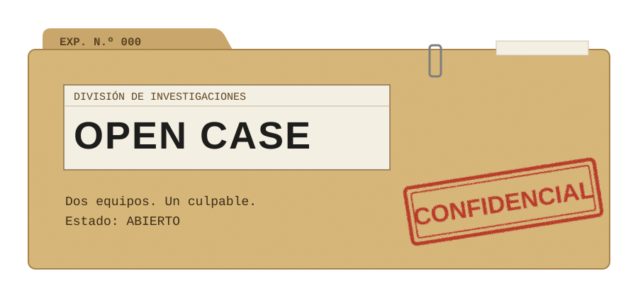
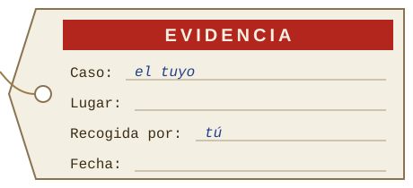

<p align="center">
  
</p>

Alguien miente. Los dos equipos tienen el mismo expediente, el mismo tiempo y las mismas preguntas posibles. Solo uno va a llegar primero al culpable.

**Open Case** es un formato para jugar casos policiales en grupo. Dos equipos investigan el mismo crimen y compiten entre sí. Una persona hace de director: es el comisario, interpreta a los sospechosos y sabe la verdad desde el principio.

No necesitas tablero ni aplicación. Basta con papel, una mesa y gente con ganas de discutir.

<p align="center">
  
</p>

## Cómo se juega

Cada equipo recibe el expediente: qué pasó, quiénes estaban y las primeras pruebas. Desde ahí, investigan.

Investigar cuesta. Cada interrogatorio, cada prueba extra y cada careo con un sospechoso gasta recursos que no alcanzan para todo. Elegir bien a quién preguntar es la mitad del juego.

Al final, cada equipo acusa a alguien y tiene que demostrarlo con lo que encontró. Gana quien arma el caso más sólido, no quien grita más fuerte.

Una partida dura más o menos una hora, con equipos de cinco a siete personas. Cada caso ajusta esos números.

## Lo que hace bueno a un caso

Hay una sola solución, y se puede llegar a ella razonando. Ninguna prueba entrega al culpable por sí sola, pero todas juntas no dejan otra salida. Las pistas falsas confunden, aunque se pueden descartar. Y el director nunca tiene que improvisar la verdad, porque está escrita en su guía.

## Arma tu propio caso



La idea es que cualquiera pueda escribir casos y ambientarlos donde quiera: su barrio, la oficina, un pueblo que no existe.

Para empezar te basta con:

1. **La verdad.** Qué pasó, quién fue, cómo y por qué. Escríbela antes que nada y no se la muestres a nadie.
2. **Una cronología.** Dónde estaba cada persona y a qué hora. Ahí aparecen las coartadas y las contradicciones.
3. **Sospechosos.** Varios con motivo u oportunidad. Si el culpable es el único raro de la lista, el caso dura cinco minutos.
4. **Pruebas.** Decide cuáles se entregan al inicio y cuáles hay que ganarse.
5. **Dos carpetas.** Una para los equipos, sin spoilers, y otra para el director, con todo.
6. **Una prueba antes de la real.** Juégalo con alguien. Los casos se arreglan jugándolos.

Más adelante habrá plantillas y una guía más completa en este repo.

<br clear="right">

## Reglas de la casa

- Cualquier lugar sirve. Open Case no está atado a ninguna ciudad.
- Se escribe en español y se va a traducir al inglés, así que conviene no depender de modismos imposibles de traducir.
- Es policial, no de terror. La tensión viene de la deducción, no de los sustos.
- El material de los equipos nunca trae la solución.

## Estado


El proyecto está en construcción. Primero hay que definir cómo se ven los expedientes, las fichas y el resto del material, y en eso estamos.

Todavía no hay casos publicados acá. Los vamos a subir cuando el diseño esté cerrado.

Las imágenes de este README son provisionales.

<br clear="right">

## Cómo se va a ordenar el repo

Es el plan por ahora, y puede cambiar.

```
open-case/
├── docs/          reglas generales, guía para crear casos, identidad visual
├── plantillas/    expediente, kit del equipo y guía del director
└── casos/
    └── <nombre-del-caso>/
        ├── equipo/    lo que reciben los jugadores
        └── director/  la solución y todo lo demás
```

<p align="center">
  
</p>
